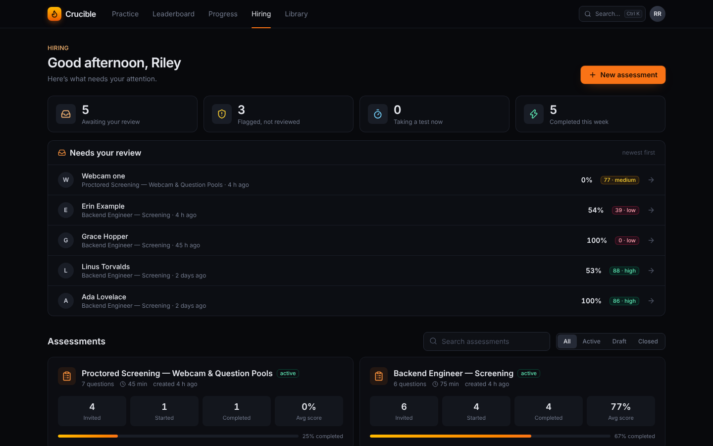
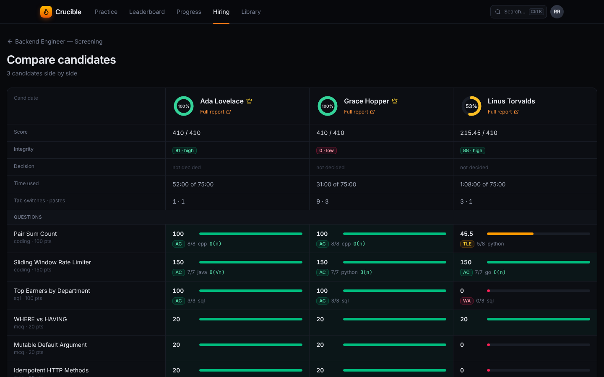
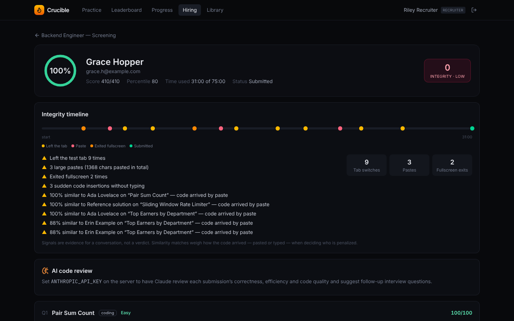
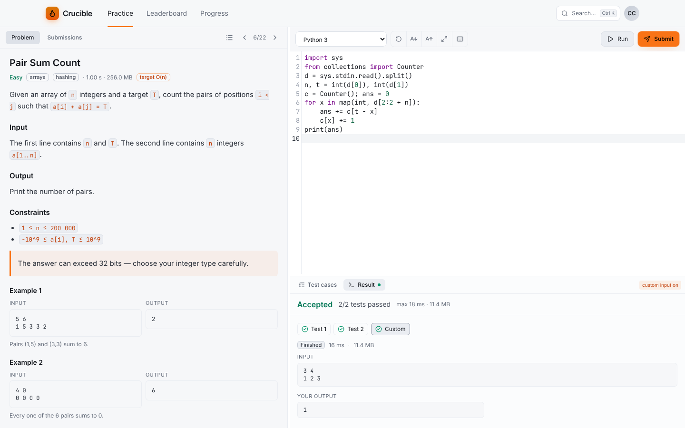
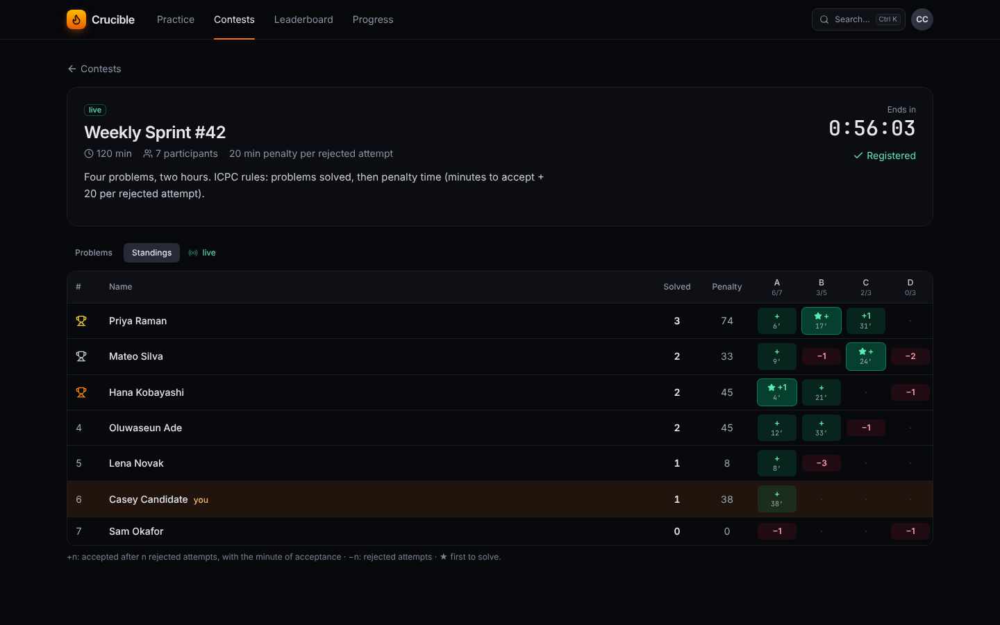
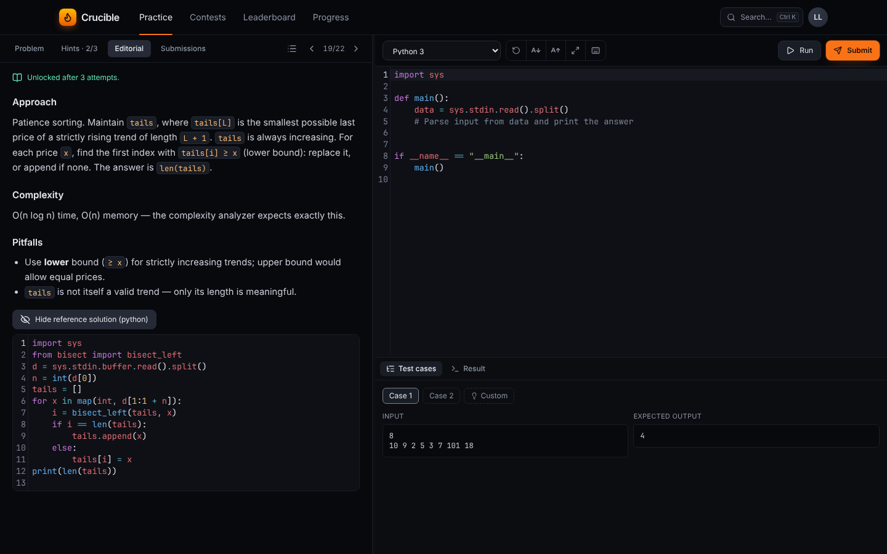

# Crucible

**Technical hiring on signal, not noise.** Crucible is a coding-assessment and practice platform in the spirit of HackerRank, built to tell a hiring team more than *"passed 7/8 tests"*: how a solution **scales**, how it was **written**, and whether the candidate **wrote it**.

| | |
|---|---|
| **Live judging** | Test results stream to the browser over SSE as each case finishes, with exact CPU time and peak memory from the sandbox. |
| **Big-O analyzer** | Accepted solutions are re-run on generated inputs of growing size; CPU time is fitted against growth models (gated by the measured log-log slope) and compared with the problem's target complexity. |
| **Hardened sandbox** | A small C supervisor runs each program with no network, a private mount namespace that hides the app and database, its own unprivileged uid, and limits on CPU, memory, processes and output. |
| **8 languages** | Python, JavaScript, TypeScript, C, C++, Java, Go and Rust. A start-up self-test compiles and runs hello-world in each language *through the sandbox*, and disables any that fail, with the reason. |
| **Question types** | Coding (exact, token, float-tolerance, any-order or custom Python checkers), **SQL** (judged against several hidden datasets) and multiple choice. |
| **Assessments** | Timed tests with private invite links, autosave, automatic submission at the deadline, and automatic judging of code that was written but never submitted. |
| **Code playback** | Scrub through how each answer was written. Sudden insertions and pastes are marked on the timeline. |
| **Plagiarism detection** | MOSS-style winnowing over normalized tokens, across candidates *and* against reference and known public solutions. Renaming variables doesn't hide a copy, and shared starter code is excluded (a "base file"). |
| **Webcam proctoring** *(opt-in)* | A snapshot at the start and about every N seconds, with jittered timing. Faces are detected **in the candidate's browser** (MediaPipe BlazeFace, served by Crucible); evidence is captured when nobody, or more than one person, is in view. If the camera disconnects, the test is blocked until it's reconnected. |
| **Identity check** *(opt-in)* | A selfie and a photo ID before the test, shown next to the snapshots in the report. |
| **Lockdown** *(opt-in)* | Block pasting from outside the test (copy/paste within the candidate's own code still works), block copying question text, lock the test to one browser, detect a second display or a duplicate tab. |
| **Device & network checks** | Every test records the IP address, a browser id and a device fingerprint. Two candidates on the same browser or device are flagged; a shared network is shown as context only. |
| **Question pools** | Each candidate draws a random, reproducible selection from pools of equal-value questions, so answers are harder to share. |
| **Fair integrity scoring** | Tab switches, fullscreen exits and large pastes feed an integrity score. When two candidates match, authorship evidence (paste or burst versus steady typing) decides who is penalized. |
| **AI review** *(optional)* | With `ANTHROPIC_API_KEY` set, Claude writes a structured review per attempt: correctness, efficiency, code quality, strengths, concerns and follow-up interview questions. |
| **Practice mode** | Problem list with filters, submission history, points, global rank, streaks, an activity heatmap and a skill radar. |
| **Hints and editorials** | Every built-in problem has 3 progressive hints (nudge → key idea) and an editorial with approach, complexity, pitfalls and the reference solution. Hints are revealed one at a time; the editorial opens after an accepted solution or 3 attempts. Both are withheld during live contests and from candidates taking an assessment that contains the question. |
| **Contests** | Scheduled rounds with ICPC scoring (solved, then penalty minutes + 20 per rejected attempt), first-to-solve markers, a scoreboard freeze for the last N minutes, and standings that update live over SSE. Staff create contests from the question library. |
| **Team hiring** | Share an assessment with colleagues as **editor** (can change it and invite) or **reviewer** (read-only). Reviewers mark each integrity flag *explained* or *concern* with a note; the report shows how many flags are reviewed. |
| **Reviewer workflow** | A "needs your review" queue, candidate search, filters and sorting, side-by-side comparison of up to 4 candidates, Advance / Hold / Reject decisions with notes, CSV export, and print-ready reports (save as PDF). |
| **Polished UI** | Light, dark and system themes with an editor that matches; a Ctrl/⌘+K command palette; an IDE with test-case and result tabs, adjustable font size, focus mode and remembered layout; mobile navigation; toasts and skeleton loaders. |
| **Fast and accessible** | Routes and editor language grammars load on demand (landing page JS went from 1,075 KB to 255 KB). Every main page passes an automated WCAG 2.1 AA audit (axe-core) in both themes. |

See [`docs/PRODUCT.md`](docs/PRODUCT.md) for the product brief and roadmap.

| Hiring dashboard | Side-by-side comparison |
|---|---|
|  |  |
| **Candidate report with decision** | **IDE (light theme)** |
|  |  |
| **Live contest standings** | **Hints and editorial** |
|  |  |

---

## Quick start

Requirements: **Linux**, Node.js ≥ 22.13, `gcc`, and the toolchains for the languages you want (`python3`, `g++`, `javac`/`java`, `go`, `rustc`). Running the server as **root** turns on full isolation (per-run uids plus network and mount namespaces). Without root, limits are still enforced, but the UI and `/api/meta` report isolation as off.

```bash
npm install
npm run dev        # API on :4000 with reload + Vite on :5173 → open http://localhost:5173
```

The first start builds the sandbox supervisor, self-tests every language, and seeds an empty database with:

- 24 questions: 14 coding, 3 SQL and 7 multiple choice. Their hidden-test outputs are computed by running the reference solutions in the judge.
- In development only, **demo accounts**: `recruiter@crucible.dev`, `candidate@crucible.dev` and `admin@crucible.dev`, all with password `crucible123`.
- A demo assessment, **"Backend Engineer — Screening"**, with three simulated candidates judged for real: a strong one, an average one whose O(n²) solution times out, and one who copied code from another candidate and the reference solution.

The landing page has one-click *"Try as a hiring manager"* and *"Try as a candidate"* buttons.

Production build (one process serves the API and the built client):

```bash
npm run build
NODE_ENV=production ADMIN_EMAIL=you@company.com ADMIN_PASSWORD='a-long-password' npm start
```

### Docker

```bash
docker compose up --build                 # http://localhost:4000
SEED_DEMO=1 docker compose up --build     # with the demo accounts and assessment (evaluation only)
```

The image installs every toolchain system-wide. Compose grants `SYS_ADMIN` and unconfined seccomp/AppArmor so the supervisor can create namespaces; without them the judge still runs and enforces limits, but reports isolation as off. *(The Dockerfile was written alongside the rest of the code but has not been built in the development environment, which had no Docker daemon. Treat the first build as a smoke test.)*

### Configuration

| Variable | Default | Purpose |
|---|---|---|
| `PORT` / `HOST` | `4000` / `0.0.0.0` | HTTP listener |
| `DATA_DIR` | `./data` | SQLite database location (created `0700`, file `0600`) |
| `BOX_ROOT` | `/var/tmp/crucible` | Sandbox working directories. Must not be inside a hidden path |
| `JUDGE_WORKERS` | `min(4, CPUs)` | Concurrent sandbox slots, each with its own uid |
| `SANDBOX_UID_BASE` | `61000` | First sandbox uid (slot *i* runs as `base + i`) |
| `SANDBOX_HIDE` | — | Extra paths to hide from sandboxed programs (`:`-separated) |
| `MEDIA_DIR` | `$DATA_DIR/media` | Proctoring images (files `0600`, never served without a staff session) |
| `SEED_DEMO` | `1` in dev, `0` in prod | Install demo accounts (published password) and the demo assessment |
| `ADMIN_EMAIL` / `ADMIN_PASSWORD` | — | First admin account, created on an empty database |
| `ANTHROPIC_API_KEY` | — | Turns on AI review. Nothing is sent anywhere without it |
| `CRUCIBLE_AI_MODEL` | `claude-opus-5-5` | Model used for AI review |
| `INSECURE_COOKIES` | — | Set to `1` to allow session cookies over plain HTTP in production |

---

## How it works

```
 Browser (React + CodeMirror)                     Server (Fastify, node:sqlite)
 ┌──────────────────────────────┐   REST + SSE   ┌──────────────────────────────────────────────┐
 │ Practice · Assessments · Test │ ─────────────▶ │ routes ─▶ JudgeService (queue, live events)   │
 │ Reports · Library · Playback  │ ◀───────────── │              │                                │
 └──────────────────────────────┘  live results  │              ▼                                │
                                                 │ Judge: compile ▸ run tests ▸ check ▸ Big-O    │
                                                 │              │                                │
                                                 │              ▼ one slot = one uid             │
                                                 │ crucible-runner (C):                          │
                                                 │   fork ▸ rlimits ▸ unshare(NET|NS)            │
                                                 │   ▸ hide app+data dirs ▸ setuid ▸ exec        │
                                                 │   ▸ poll CPU/RSS ▸ wait4 → JSON verdict       │
                                                 └──────────────────────────────────────────────┘
```

### The sandbox (`server/sandbox/runner.c`)

For every compile and every test case:

1. Opens stdin, stdout and stderr files **as root** (inputs and outputs live in a root-only directory, never in the program's working directory).
2. `unshare(CLONE_NEWNET)` gives the process an empty network namespace.
3. `unshare(CLONE_NEWNS)` plus read-only tmpfs mounts over the **repository and data directories**, so a submission can't read hidden tests from the database or the seed files.
4. Rlimits: `CPU`, `AS` (for languages where it's meaningful), `STACK`, `FSIZE`, `NPROC` (counted against the slot's own uid) and `CORE=0`. Then `setgroups`/`setgid`/`setuid` to the slot uid and `PR_SET_NO_NEW_PRIVS`.
5. The parent polls `/proc/<pid>` for CPU time and RSS every 2 ms, kills the process group on CPU, wall-clock or memory overrun, and reads exact usage from `wait4`.

The test suite verifies each of these properties: network blocked, app directory empty, non-zero uid, fork bomb contained, and TLE, MLE and OLE detected.

**Limits of this design.** This is process-level isolation, the same class as classic judges like the IOI's `isolate`. It is not a VM. There is no seccomp syscall filter yet, and the kernel is shared. For a hostile multi-tenant deployment, run the judge inside gVisor or Firecracker, or give it a dedicated machine. Hardening steps are on the roadmap.

### Big-O analyzer (`server/src/judge/complexity.ts`)

Problems may declare a target complexity, input sizes, and a Python `generate(n)` function. After a solution is accepted, the judge:

1. Generates the inputs (cached), then runs the solution at each size, keeping the faster of two runs. It stops early if the solution exceeds the time budget.
2. Fits `t = a·f(n) + b` for O(1), O(log n), O(√n), O(n), O(n log n), O(n²), O(n³) and O(2ⁿ).
3. Uses the log-log slope over the upper half of the range to rule out implausible models, then picks the simplest model whose error is close to the best.

Output: the estimated class, whether it meets the target, the slope, and a chart of measured times against the target curve. It is an empirical estimate, and the UI says so. Distinguishing O(n) from O(n log n) over a short range is inherently unreliable, so O(n) counts as meeting an O(n log n) target.

### Integrity and plagiarism (`server/src/integrity/plagiarism.ts`, `server/src/scoring.ts`)

- **Normalization:** comments and string contents are stripped, identifiers become `V` and numbers become `N`, while language keywords are kept.
- **Fingerprinting:** hashed 6-gram winnowing (window 5), with similarity measured as the overlap coefficient. The required similarity rises for short programs, which collide by chance more often.
- Candidates are compared with each other on every question, and coding answers are also compared with the reference and known public solutions.
- **Authorship evidence:** a match carries a full penalty only when the candidate's code for that question arrived by a large paste or a sudden insertion visible in playback. Code typed up incrementally that matches someone else is labelled *"may be the original"*. A typed-up match with a known solution is informational, because canonical problems have canonical answers.

On the built-in data, copies score 1.00 and independently written solutions score 0.00–0.06.

---

### Proctoring and cheating prevention (`server/src/proctor.ts`, `server/src/media.ts`, `web/src/components/proctor/`)

Everything is configured per assessment, and the candidate's intro page lists exactly what that assessment collects.

| Signal | How it's collected | Prevention | In the report |
|---|---|---|---|
| Webcam | JPEG snapshot at the start and about every 15–120 s (jittered); faces counted on-device; extra evidence shots when no face is seen for about 10 s or more than one face appears | Test blocked while the camera is disconnected | Snapshot gallery, flagged frames, "not on camera *n* of *m*" |
| Identity | Selfie and ID photo before starting (camera or upload) | Required to start | Shown side by side with the snapshots |
| Paste | Clipboard text is checked against what was copied *inside* the test | External pastes and drag-and-drop are blocked | Blocked attempts on the timeline |
| Copying questions | Copy, cut and the context menu on the statement | Blocked | Attempts on the timeline |
| Device | Per-browser id plus a SHA-256 device fingerprint, sent on every request | Optional lock to the first browser; staff can unlock | Devices table; other candidates seen on the same browser, device or network |
| Displays and tabs | `screen.isExtended`; `BroadcastChannel` | Warning banner; the second tab is blocked | Timeline events |
| Question sharing | Seeded per-candidate draw from each pool | Different candidates get different questions | The questions each candidate drew |

**Image handling.** Uploads must be real JPEG or PNG files (magic bytes checked against the declared type), up to 450 KB each. Snapshots are limited to one per 8 seconds and identity photos to 5 per kind. Images are stored outside the web root (files `0600`, directories `0700`) and served only to staff who own the assessment. Images, ID photos and IP/device logs are deleted automatically after the assessment's retention period (7–365 days, default 90), and staff can delete them earlier from a report.

**Limits, honestly.** The browser is the candidate's environment. A determined candidate can use a second device out of view of the camera, or a virtual camera. These signals raise the cost of cheating and give reviewers evidence; they don't make cheating impossible. Face detection counts faces, it doesn't recognize them: comparing the selfie, ID and snapshots is a human step. Second-display detection needs a Chromium-based browser. There is no audio monitoring or screen recording.

## Testing

```bash
npm test            # 90 tests, about 3 minutes
npm run e2e         # 13 browser tests: user flows + WCAG 2.1 AA audits (Playwright)
npm run typecheck
```

| Suite | What it proves |
|---|---|
| `sandbox.test.ts` | Limits (TLE, MLE, OLE, RE), no network, hidden application directory, unprivileged uid, fork-bomb containment, box cleanup |
| `judge.test.ts` | Accepted solutions in every available language; WA with weighted partial credit; CE, RE and TLE; custom input; custom checkers; full-length expected outputs; SQL (including blocked `ATTACH`); complexity, checker and plagiarism units |
| `problems.test.ts` | Every built-in problem's reference solution passes, **and an independently written solution in another language agrees on all of its tests** |
| `api.test.ts` | Auth; practice run and submit; **hidden tests never leak to candidates**; candidates can't reach staff APIs; recruiters can't see each other's candidates; tokens are scoped to attempts; the full assessment flow; deadline expiry; question validation |
| `contests.test.ts` | ICPC ranking, penalties, first-to-solve and ties; scoreboard freeze for participants but not organizers; submissions only while running and only for contest problems; problems hidden until the start; only staff create contests |
| `learn.test.ts` | Hints revealed strictly in order and remembered; editorial unlocks (accepted, 3 attempts, staff); nothing leaks on the problem page; withheld during a live contest; validation; backfill of older databases |
| `proctoring.test.ts` | Pool draws (count, determinism, variety, scoring, validation); media accepted only when enabled; forged or oversized images rejected; rate limits; identity required to start; image access control; device lock, unlock and refused-device logging; device-switch logging; shared browser vs shared network; lockdown signals; retention deletion |

The webcam flow was also verified in Chromium with a fake camera fed a public-domain portrait (one face), two copies side by side (two faces) and a blank frame (no face).

Isolation tests need root and are skipped automatically otherwise (CI runs unprivileged).

---

## Project layout

```
server/
  sandbox/runner.c          sandbox supervisor (built automatically at start-up)
  src/judge/                languages, sandbox pool, judge, checkers, complexity analyzer
  src/integrity/            winnowing plagiarism detector
  src/routes/               auth, practice, library, assessments, test-taking, contests, learn
  src/contests.ts           ICPC standings, freeze
  src/scoring.ts            attempt scoring + integrity report
  src/ai.ts                 optional Claude review (structured output)
  src/seed/                 problem set, hints and editorials, demo candidates and contests
  test/                     node:test suites
web/
  src/pages/                Landing, Problems, Solve, Dashboard, Hiring, Report, Library, TakeTest…
  src/components/           Workspace (IDE), ResultsPanel (live), Playback, charts
e2e/                        Playwright smoke flows + axe accessibility audits
docs/PRODUCT.md             product brief, personas, roadmap
```

## API overview

| Area | Endpoints |
|---|---|
| Auth | `POST /api/auth/register · login · logout`, `GET /api/auth/me`, `GET /api/meta` |
| Practice | `GET /api/problems`, `GET /api/problems/:slug`, `POST /api/problems/:slug/answer`, `GET /api/me/stats`, `GET /api/leaderboard` |
| Learning | `GET /api/problems/:slug/learn`, `POST /api/problems/:slug/hints/:n`, `GET /api/problems/:slug/editorial` |
| Contests | `GET /api/contests`, `GET /api/contests/:slug`, `POST …/join`, `GET …/problems/:label`, `GET …/submissions`, `GET …/standings`, `GET …/standings/stream` (SSE), `POST /api/contests` *(staff)* |
| Judging | `POST /api/submissions`, `GET /api/submissions/:id`, `GET /api/submissions/:id/stream` (SSE) |
| Library *(staff)* | `GET/POST /api/library/questions`, `GET/PUT/DELETE /api/library/questions/:id`, `POST …/:id/validate`, `POST /api/library/run-reference` |
| Assessments *(staff)* | `GET/POST /api/assessments`, `GET/PUT /api/assessments/:id`, `POST …/:id/invites`, `GET …/:id/plagiarism`, `GET /api/attempts/:id`, `POST /api/attempts/:id/ai-review`, `GET/POST …/:id/members`, `PUT /api/attempts/:id/flags`, `PUT /api/attempts/:id/review` |
| Test-taking *(token)* | `GET /api/take/:token`, `POST …/start`, `PUT …/answers/:questionId`, `POST …/events`, `POST …/submit` |
